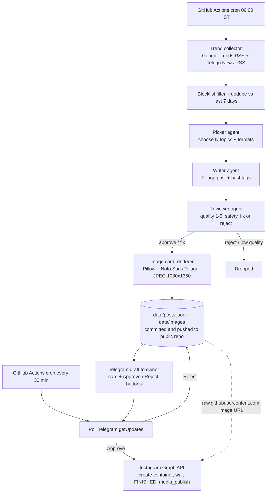

# Architecture

## Goals

- Publish Telugu trend content to **Instagram** at zero recurring cost, with no servers to run
- Good Telugu quality through a separate reviewer pass and human approval
- Safe by default: no politics, tragedies, or sensitive topics

## Flow

## Why these choices

- **GitHub Actions instead of a server.** Scheduled jobs are free (public repo) and need no hosting. The agent is stateless between runs; state lives in JSON files in the repo.
- **Image cards.** Instagram has no text-only posts. A rendered card is the cheapest format that still carries the Telugu text. Pillow with libraqm shapes Telugu conjuncts correctly, and the Noto Sans Telugu font is bundled (SIL OFL) so rendering doesn't depend on the runner's fonts.
- **Public repo as image host.** The Instagram API pulls the image from a public URL. The repo is already public, so `raw.githubusercontent.com` is free hosting with no extra service. This is why publishing happens only after the daily job has pushed the cards.
- **Polling instead of webhooks.** A webhook needs an always-on endpoint. Polling Telegram `getUpdates` from a cron job needs nothing extra. The trade-off is up to 30 minutes of approval latency; trigger the workflow manually for instant publishing.
- **Publish is separate from generate.** Posts move `pending -> approved -> published`. A failed Instagram call leaves the post `approved`, so the next run retries without regenerating anything.
- **Three agents instead of one prompt.** The picker decides what, the writer focuses on voice, and the reviewer is a separate pass because LLMs make subtle Telugu mistakes the writer won't catch in its own output.
- **Gemini free tier first, Groq as fallback.** Gemini has the stronger Telugu. The agent makes about 1 + 2N calls per day (7 with N=3), far under free rate limits.
- **JSON files, not a database.** Posts are tiny, history is versioned by git, and nothing needs to be provisioned. If you outgrow it, Supabase's free tier is a drop-in replacement for `store.py`.

## Modules

| File | Role |
|---|---|
| `trends.py` | Fetch RSS feeds, strip HTML, drop blocklisted titles, dedupe |
| `llm.py` | Gemini / Groq calls with retries and JSON parsing; stubbed in dry-run |
| `agents.py` | Picker, Writer, Reviewer using templates in `prompts/` |
| `imagegen.py` | Render the Telugu text card as a JPEG |
| `instagram.py` | Graph API publishing: container, status poll, publish |
| `pipeline.py` | `generate()` and `process_approvals()` orchestration, post lifecycle |
| `telegram.py` | Private approval inbox: send card, poll button taps |
| `store.py` | JSON persistence, topic history, Telegram update offset |
| `scripts/get_ig_token.py` | One-time helper to get the Page token and Instagram user id |

## Safety layers

1. Keyword blocklist on trend titles (English and Telugu)
2. Picker prompt rules (skip politics, tragedies, sensitive topics)
3. Reviewer pass (safety verdict, quality score, fact check flag)
4. Human approval in Telegram (default)
5. Approvals only accepted from the owner's chat id

## Extending toward MCP / multi-agent

Each stage (`collect`, `pick`, `write`, `review`, `render`, `publish`) already has a clean function boundary. To expose them as MCP tools, wrap each function in an MCP server tool and let an orchestrator agent call them; the data contract between stages is plain JSON dicts.
