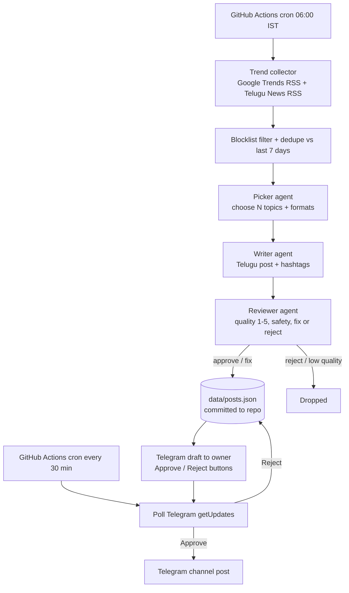

# Architecture

## Goals

- Zero recurring cost, no servers to run
- Good Telugu quality through a separate reviewer pass and human approval
- Safe by default: no politics, tragedies, or sensitive topics

## Flow

## Why these choices

- **GitHub Actions instead of a server.** Scheduled jobs are free and need no hosting. The agent is stateless between runs; state lives in JSON files in the repo.
- **Polling instead of webhooks.** A webhook needs an always-on endpoint. Polling `getUpdates` from a cron job needs nothing extra. The trade-off is up to 30 minutes of approval latency; you can trigger the workflow manually for instant publishing.
- **Three agents instead of one prompt.** The picker decides what, the writer focuses on voice, and the reviewer is a separate pass because LLMs make subtle Telugu mistakes the writer won't catch in its own output.
- **Gemini free tier first, Groq as fallback.** Gemini has the stronger Telugu. The agent makes about 1 + 2N calls per day (7 with N=3), far under free rate limits. If Gemini is down or rate-limited, Groq is used when its key is set.
- **JSON files, not a database.** Posts are tiny, history is versioned by git, and nothing needs to be provisioned. If you outgrow it, Supabase's free tier is a drop-in replacement for `store.py`.

## Modules

| File | Role |
|---|---|
| `trends.py` | Fetch RSS feeds, strip HTML, drop blocklisted titles, dedupe |
| `llm.py` | Gemini / Groq calls with retries and JSON parsing; stubbed in dry-run |
| `agents.py` | Picker, Writer, Reviewer using templates in `prompts/` |
| `pipeline.py` | `generate()` and `process_approvals()` orchestration |
| `telegram.py` | Send drafts, poll button taps, publish |
| `store.py` | JSON persistence, topic history, Telegram update offset |

## Safety layers

1. Keyword blocklist on trend titles (English and Telugu)
2. Picker prompt rules (skip politics, tragedies, sensitive topics)
3. Reviewer pass (safety verdict, quality score, fact check flag)
4. Human approval in Telegram (default)
5. Approvals only accepted from the owner's chat id

## Extending toward MCP / multi-agent

Each stage (`collect`, `pick`, `write`, `review`, `publish`) already has a clean function boundary in `pipeline.py` and `agents.py`. To expose them as MCP tools, wrap each function in an MCP server tool and let an orchestrator agent call them; the data contract between stages is plain JSON dicts.
